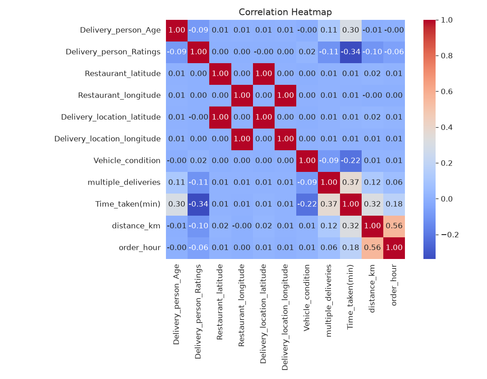
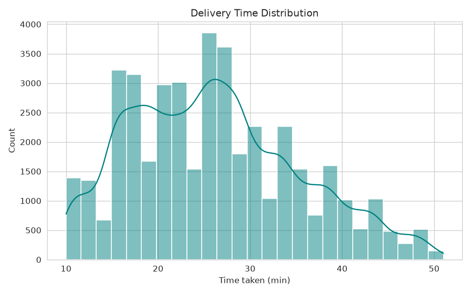
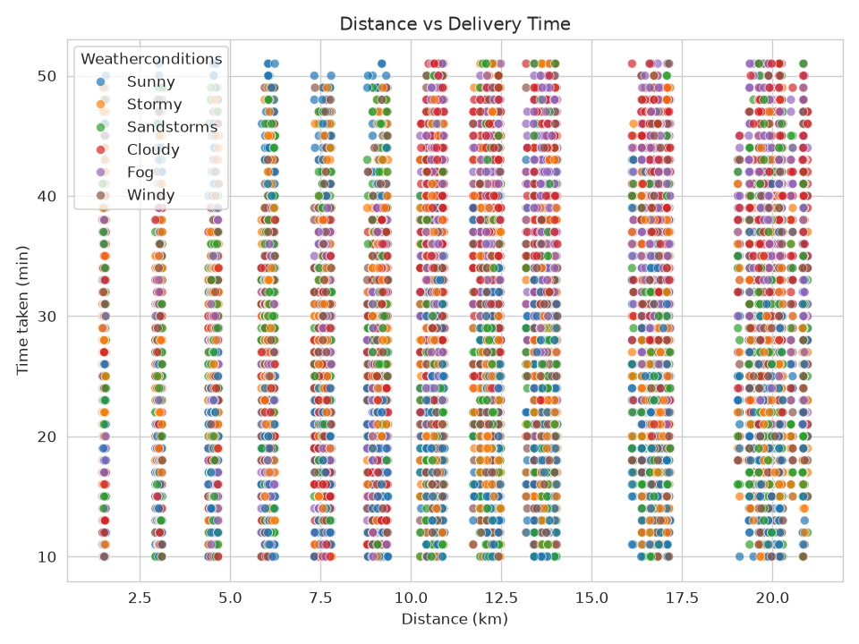
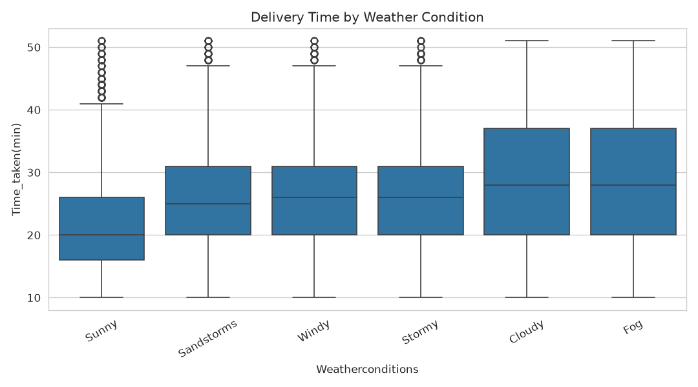
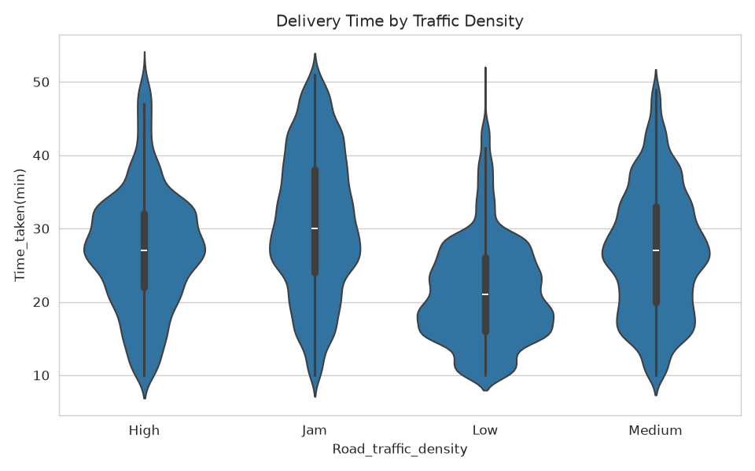
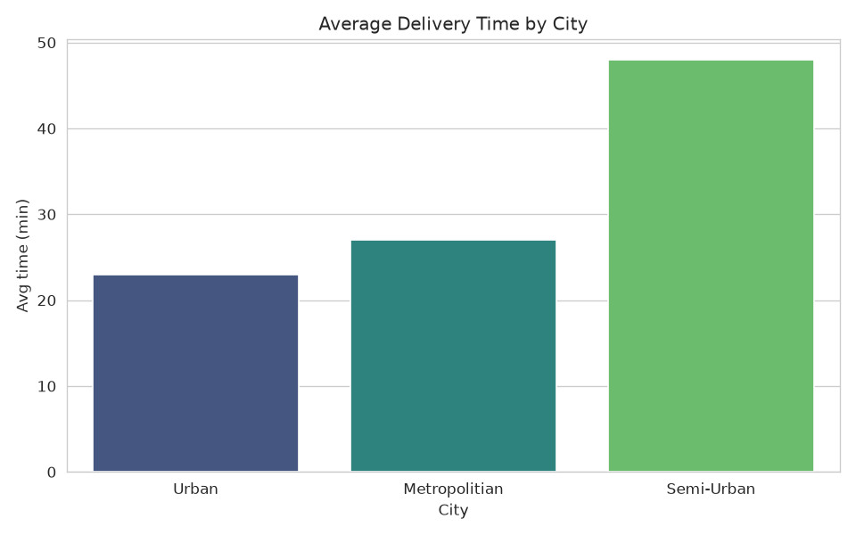
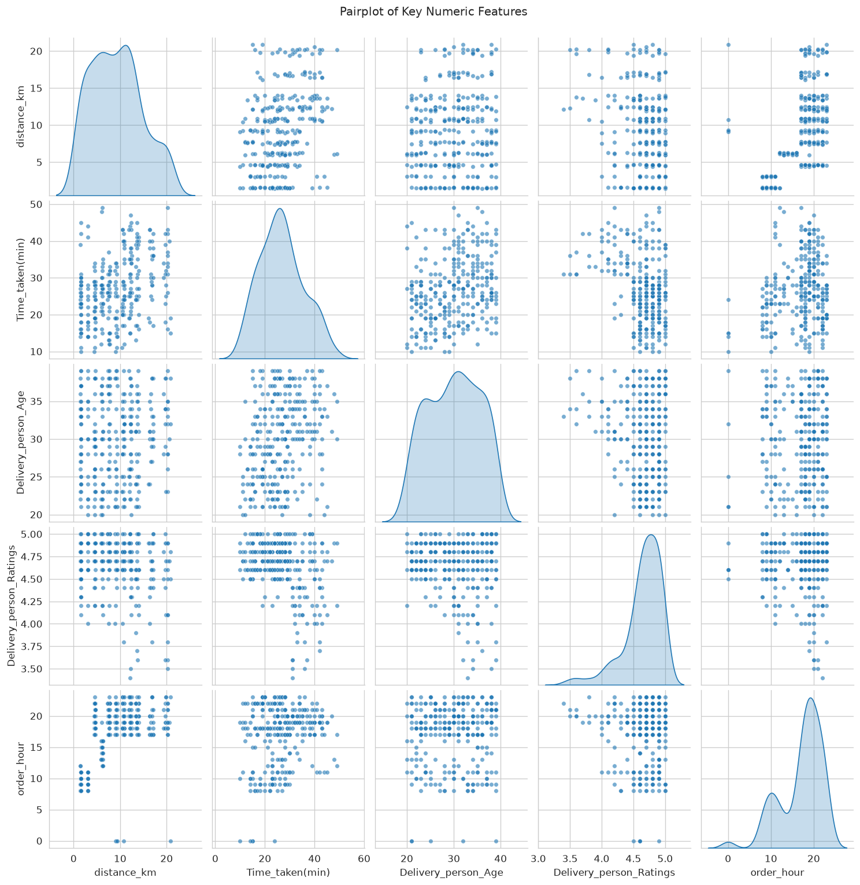
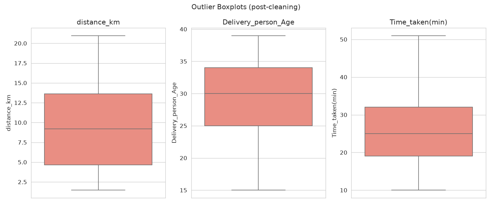
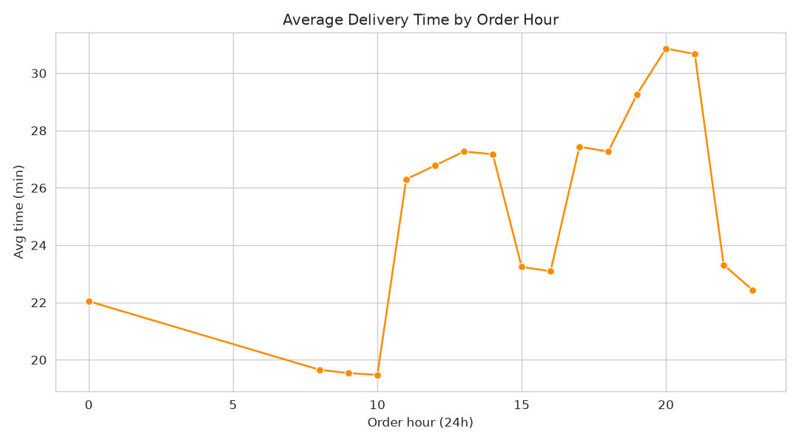
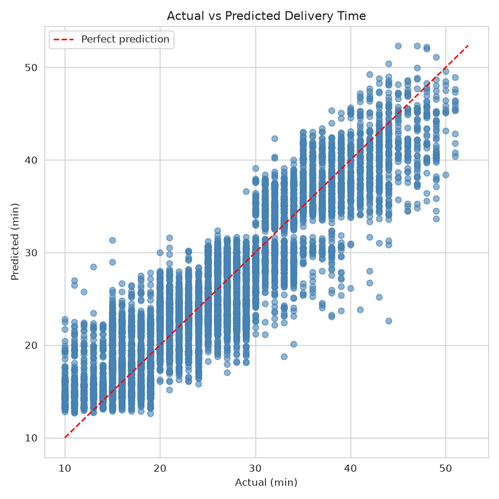

# 🍕 Food Delivery Time Prediction System

[](https://food-delivery-time-prediction-fjbdyvegs5jswszygsmptp.streamlit.app/)

**🚀 Live app:** [food-delivery-time-prediction.streamlit.app](https://food-delivery-time-prediction-fjbdyvegs5jswszygsmptp.streamlit.app/)

An end-to-end data analytics and machine learning project that predicts food delivery times using real-world delivery data — built for the **BCA V Semester course, Data Analytics using Python (BCA503)**.

From raw JSON/CSV data to a deployed, interactive web app: this project covers the full analytics lifecycle — cleaning, feature engineering, exploratory analysis, model comparison, and deployment.

---

## 📱 App Preview

| Predict Page | Dashboard Page |
|---|---|
|  |  |

*(Screenshots: fill in `assets/screenshots/predict.png` and `assets/screenshots/dashboard.png` with your own — see note below.)*

---

## 📌 Project Overview

**Goal:** Predict how long a food delivery will take (in minutes), using features like distance, weather, traffic density, order time, city type, vehicle type, and number of concurrent deliveries.

**What makes this project complete, not just a notebook experiment:**

- **Full pipeline** — raw data → cleaned data → 10 EDA visualizations → three trained models → best model deployed in a live web app
- **Real feature engineering** — Haversine distance from GPS coordinates, order-hour and weekday extraction, 1.5×IQR outlier removal
- **Clean OOP design** — a `DeliveryTimeModel` class wraps encoding, scaling, training, evaluation, and persistence behind one consistent interface
- **Model comparison, not guesswork** — Linear Regression, Random Forest, and HistGradientBoosting are trained and evaluated side by side, and the best performer is automatically selected and deployed
- **Interactive Streamlit app** — a **Predict** page (live form, instant prediction, route map, downloadable report) and a **Dashboard** page (dataset preview, model metrics, full EDA gallery)

---

## 📊 Dataset

**Source:** India Food Delivery Time Prediction dataset (Kaggle), ~456+ delivery records with 20+ columns.

| Column | Description |
|---|---|
| `Delivery_person_Age`, `Delivery_person_Ratings` | Rider demographics and performance |
| `Restaurant_latitude/longitude`, `Delivery_location_latitude/longitude` | GPS coordinates used to compute distance |
| `Order_Date`, `Time_Orderd`, `Time_Order_picked` | Order timing |
| `Weatherconditions`, `Road_traffic_density` | Environmental conditions |
| `Vehicle_condition`, `Type_of_vehicle` | Delivery vehicle details |
| `Type_of_order`, `multiple_deliveries`, `Festival`, `City` | Order and context features |
| `Time_taken(min)` | **Target** — delivery duration, originally formatted as `"(min) 24"` |

---

## 🛠️ Preprocessing & Feature Engineering

Handled entirely by `src/preprocess.py`:

1. **Smart loading** — auto-detects JSON-array content even when the file carries a `.csv` or `.txt` extension
2. **String & target cleaning** — strips whitespace, normalizes `"NaN"` strings to real nulls, and regex-parses `"(min) 24"` → `24`
3. **Numeric coercion** — forces age, ratings, coordinates, and delivery counts to proper numeric types before any statistics are computed
4. **Feature engineering:**
   - `distance_km` — Haversine distance between restaurant and delivery location
   - `order_hour` — extracted from `Time_Orderd`
   - `weekday` — derived from `Order_Date`
   - Weather strings cleaned (`"conditions Sunny"` → `"Sunny"`)
5. **Missing values** — median imputation for numeric columns, mode imputation for categorical columns
6. **Outlier removal** — 1.5×IQR rule applied to `distance_km`, `Delivery_person_Age`, and `Time_taken(min)`
7. **Train/test split** — 80/20, `random_state=42` for reproducibility

Output: `data/processed/food_delivery_processed.csv`

---

## 📈 Exploratory Data Analysis

Ten visualizations generated by `src/visualize.py`, saved to [`assets/plots/`](https://github.com/hima879/food-delivery-time-prediction/tree/main/assets/plots):

### 01 · Correlation Heatmap
`distance_km` and `order_hour` are the strongest numeric correlates of delivery time.



### 02 · Delivery Time Distribution
Roughly bimodal spread between 10–50 minutes.



### 03 · Distance vs Time
Confirms the core hypothesis — longer distance, longer delivery — colored by weather condition.



### 04 · Time by Weather Condition
Cloudy/Fog conditions show the widest spread and highest medians.



### 05 · Time by Traffic Density
Jam and High traffic push delivery times up noticeably.



### 06 · Average Time by City
Semi-Urban areas average the slowest deliveries.



### 07 · Pairplot
Joint view of distance, age, ratings, hour, and the target variable.



### 08 · Outlier Boxplots
Confirms the IQR filter worked — tight boxes, minimal extreme points.



### 09 · Hourly Time Series
Clear rush-hour spikes around lunch and evening.



### 10 · Actual vs Predicted
Tight clustering around the diagonal — validates the deployed model's quality.



---

## 🤖 Modeling

Three regression models were trained and evaluated head-to-head in `src/model_train.py`, each wrapped by the same `DeliveryTimeModel` class (encoder + scaler + model, with `fit`, `predict`, `evaluate`, `save`, `load`):

| Model | R² | RMSE (min) | MAE (min) |
|---|---|---|---|
| Linear Regression (baseline) | 0.577 | 5.892 | 4.709 |
| Random Forest | 0.820 | 3.845 | 3.058 |
| **HistGradientBoosting** 🏆 | **0.822** | **3.820** | **3.044** |

**Winner: HistGradientBoosting**, selected automatically and deployed. It explains ~82% of the variance in delivery time — a strong result, and a 42-point R² jump over the linear baseline, confirming that delivery time has genuinely non-linear relationships with distance, traffic, and weather that a straight-line model simply can't capture.

**`DeliveryTimeModel` class** handles:
- `fit(X_train, y_train)` — fits the encoder, scaler, and underlying model together
- `predict(X)` — transforms and predicts in one call
- `evaluate(X_test, y_test)` — returns R², MSE, RMSE, MAE
- `save(model_dir)` / `load(model_dir)` — persists/restores the full artifact set (model, encoder, scaler, feature columns, metrics)

---

## 🖥️ Web Application (Streamlit)

### Predict Page
A live form — distance, weather, traffic, order hour, city, order type, vehicle type, multiple deliveries, and festival flag — returns an instant prediction with an RMSE-based error margin, an illustrative Folium route map between restaurant and customer, and a downloadable CSV report of the inputs and result.

### Dashboard Page
Shows the processed dataset preview, live model performance metrics (R², RMSE, MAE, MSE), and the full 10-plot EDA gallery in a tabbed view.

Run it:
```bash
streamlit run app.py
```

---

## 📁 Project Structure

```
food_delivery_prediction/
├── data/
│   ├── raw/                     # original dataset (CSV/JSON)
│   └── processed/                # cleaned, feature-engineered data
├── src/
│   ├── preprocess.py             # loading, cleaning, feature engineering
│   ├── model_train.py            # DeliveryTimeModel class + 3-model comparison
│   ├── visualize.py               # 10 EDA plots
│   └── utils.py                   # Streamlit helper functions
├── models/                        # saved model, encoder, scaler, metrics
├── assets/
│   └── plots/                     # all 10 EDA chart PNGs
├── app.py                         # Streamlit application
├── requirements.txt
└── README.md
```

---

## 🚀 Running the Project

```bash
pip install -r requirements.txt

python src/preprocess.py     # clean + engineer features
python src/model_train.py    # train, compare, and save the best model
python src/visualize.py      # generate all 10 EDA plots
streamlit run app.py         # launch the web app
```

**🚀 Live deployment:** [food-delivery-time-prediction.streamlit.app](https://food-delivery-time-prediction-fjbdyvegs5jswszygsmptp.streamlit.app/) — deployed on Streamlit Community Cloud. The `models/` folder and processed CSV are committed to the repo so the app loads instantly without retraining.

---

## 🔮 Future Improvements

- Hyperparameter tuning (grid/random search) on HistGradientBoosting to push past R² 0.82
- Live weather and traffic API integration for real-time feature updates
- SHAP-based feature importance for model explainability
- CI/CD pipeline for automated retraining and deployment

---

## 🙏 Acknowledgments

Built as part of the Data Analytics using Python (BCA503) coursework — a complete walk through the real-world ML workflow: messy real data, honest model comparison, and a working deployed product at the end of it.
